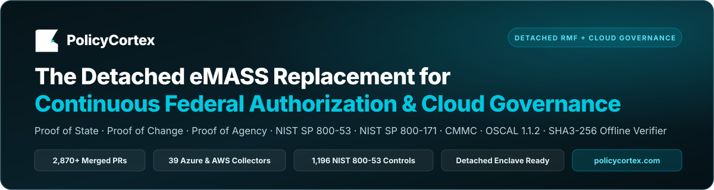
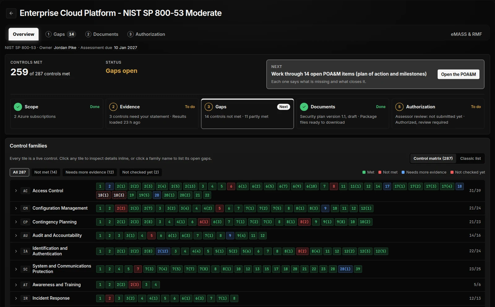

<div align="center">

<a href="https://policycortex.com">
  
</a>

<br><br>

<a href="https://policycortex.com"><b>Website</b></a>
&nbsp;&middot;&nbsp;
<a href="https://policycortex.com/platform/ato-authorization"><b>Continuous ATO</b></a>
&nbsp;&middot;&nbsp;
<a href="https://policycortex.com/architecture"><b>Architecture</b></a>
&nbsp;&middot;&nbsp;
<a href="https://app.policycortex.com"><b>Platform Sign-In</b></a>
&nbsp;&middot;&nbsp;
<a href="https://github.com/PolicyCortex"><b>@PolicyCortex</b></a>
&nbsp;&middot;&nbsp;
<a href="https://www.linkedin.com/in/leonardesere/"><b>LinkedIn</b></a>
&nbsp;&middot;&nbsp;
<a href="mailto:esere@policycortex.com"><b>esere@policycortex.com</b></a>

<br><br>


</div>

<br>

## Building PolicyCortex: The Detached eMASS Replacement

Legacy federal **eMASS** acts as a static document repository disconnected from live cloud infrastructure, forcing security teams to spend months assembling point-in-time screenshots and spreadsheets that go stale overnight. Commercial compliance SaaS tools require sending sensitive telemetry to a vendor-hosted multi-tenant control plane, which federal programs and national laboratories reject.

**[PolicyCortex](https://policycortex.com)** unifies **continuous RMF authorization** (`NIST SP 800-53`, `NIST SP 800-171`, `CMMC`) and **live multi-cloud governance** (`Azure`, `AWS`, `GCP`, with support for `Azure Government`, `AWS GovCloud (US)`, and `GCC High`) in a single platform built to deploy **detached inside the customer's own cloud boundary** (or as a U.S.-hosted service).

### Three Core Pillars

| Pillar | What It Delivers |
| :--- | :--- |
| **Proof of State** | `39` read-only evidence collectors (`30` Azure, `9` AWS) plus GCP estate inventory mapped directly across `1,196` NIST SP 800-53 controls and enhancements, `110` NIST SP 800-171 requirements, and `66` MITRE ATLAS techniques. Missing observations are logged explicitly as declared gaps rather than silently omitted. |
| **Proof of Change** | Continuous posture evaluation via **OPA (Open Policy Agent)**, **Steampipe**, and **Cloud Custodian** tied straight into a single live implementation record that generates **SSP**, **SAR**, and **POA&M** artifacts, **OSCAL 1.1.2** JSON bundles, and **24-column eMASS POA&M (`.xlsx`)** worksheets. |
| **Proof of Agency** | `49` typed remediation actions governed by operator-set trust modes, human approval gates, a `0.9` confidence floor, blast-radius bounds, rollback, and emergency-stop controls. |

<hr>

### Live Product Showcase (Synthetic Demo Workspace)

<table>
  <tr>
    <td width="50%" valign="top">
      <b>Unified Multi-Cloud Governance &amp; Command Center</b><br>
      <sub>Live Azure, AWS, and GCP findings, live SPRS readiness, and human-gated remediation approvals in one cockpit.</sub><br><br>
      
    </td>
    <td width="50%" valign="top">
      <b>eMASS &amp; RMF 287-Control Readiness Workspace</b><br>
      <sub>5-stage RMF readiness rail (Scope, Evidence, Gaps, Documents, Authorization) and live interactive NIST SP 800-53 matrix.</sub><br><br>
      
    </td>
  </tr>
  <tr>
    <td colspan="2" valign="top">
      <b>Assessor-Ready Package Export &amp; Offline SHA3-256 Evidence Chain</b><br>
      <sub>Every exported ATO package bundles SSP, SAR, POA&amp;M, OSCAL 1.1.2 JSON, eMASS formats, and an offline Python verifier so any authorizing official or assessor can independently recompute the hash chain with no PolicyCortex account.</sub><br><br>
      
    </td>
  </tr>
</table>

### Detached Customer-Operated Deployment & Offline Verification

In a customer-operated installation, PolicyCortex runs inside the organization's own **Azure Government**, **Azure Commercial**, or **Kubernetes** boundary with **zero control-plane telemetry and zero evidence egress back to PolicyCortex**. Authorizing official decisions are recorded against the frozen package they rested on, with hourly tolerance evaluations and offline tamper detection:

```text
$ python3 Evidence_History/verify_ledger.py Evidence_History/ledger.jsonl
PolicyCortex evidence stream verification (SHA3-256)
stream: Evidence_History/ledger.jsonl
status: INTACT
headDigest: 9496e0defd46052a2285bfa9cdb68336eedb18f8ee6e622e8953caa690e866e9
records: 721 (state_capture 721, change_record 0, declared_gap 0, agency_record 0)
ledger.json: sha3Chain head digest and counts match
Exit code: 0
```

### Engineering Stack & Delivery

| Layer | Technologies |
| :--- | :--- |
| **Frontend & Admin** | Next.js 16 (App Router), TypeScript, shadcn/ui, TanStack Query, Zustand |
| **Backend & Data** | Express, TypeScript, Prisma 6, PostgreSQL, Redis, BullMQ, Socket.IO |
| **Policy & Collectors** | Open Policy Agent (OPA), Steampipe, Cloud Custodian, 39 Azure & AWS collectors |
| **Packaging & Runtime** | Docker, Helm / Kubernetes (detached enclave kits), AWS ECS Fargate, Cloudflare, Prometheus, Grafana, OpenTelemetry |
| **Production Status** | `2,870+` merged pull requests · Live in production and in use with paying customers (Patent pending.) |

<hr>

### Background & Federal Track Record

- **12 years** architecting and securing regulated enterprise and federal cloud environments across **Los Alamos National Laboratory**, **MITRE**, **Frontier Airlines**, **USAA**, **Hippo Insurance**, and **Medtronic**.
- Personally authored and delivered **7 NIST SP 800-53 / RMF Authorization to Operate (ATO) packages**: **4** at Los Alamos National Laboratory (Azure Commercial, Azure Government, AWS Red, and AWS Yellow enclaves) and **3** at MITRE.
- Active **DOE Q** and **DoD Secret** clearances.

<br>

<div align="center">


<br><br>


<br><br>

<a href="https://policycortex.com"><b>PolicyCortex</b></a>
&middot; Founder &middot;
<a href="https://github.com/PolicyCortex"><b>github.com/PolicyCortex</b></a>
&middot;
<a href="https://www.linkedin.com/in/leonardesere/"><b>LinkedIn</b></a>
&middot;
<a href="mailto:esere@policycortex.com"><b>esere@policycortex.com</b></a>

<br>

<sup>Texas, USA · Prove the mechanism instead of asking for trust.</sup>

</div>
