  

<b>Founder, <a href="https://policycortex.com">PolicyCortex</a></b>
&nbsp;&middot;&nbsp;
Building the detached eMASS replacement uniting continuous RMF authorization (NIST SP 800-53, NIST SP 800-171, CMMC) and live multi-cloud governance in one customer-deployed system.
 
12 years in enterprise and federal cloud security · 7 NIST SP 800-53 / RMF ATO packages delivered · Live in production and in use with customers.

  

<a href="https://policycortex.com"><b>policycortex.com</b></a>
&nbsp;&middot;&nbsp;
<a href="https://github.com/PolicyCortex"><b>@PolicyCortex Showcase</b></a>
&nbsp;&middot;&nbsp;
<a href="https://policycortex.com/architecture"><b>Architecture</b></a>
&nbsp;&middot;&nbsp;
<a href="https://www.linkedin.com/in/leonardesere/"><b>LinkedIn</b></a>
&nbsp;&middot;&nbsp;
<a href="mailto:esere@policycortex.com"><b>esere@policycortex.com</b></a>

  

  

 

Texas, USA · Prove the mechanism instead of asking for trust.

